# Current demo

## Control flow

```mermaid
flowchart TD
    subgraph SetupScope["Input and setup: CLI / ConversionLoop.create"]
        Input["Read Jenkinsfile"]
        Setup["Validate input, create output directory and copy source"]
    end

    subgraph RunScope["ConversionLoop.run: bounded orchestration"]
        Round{"Another round available? (bounded for loop)"}
        StartRound["Create round report and round directory"]

        subgraph ConvertScope["ConversionLoop._convert"]
            Convert["Converter call"]
            ParseConversion{"Valid structured conversion?<br/>Deterministic Python checks:<br/>JSON format and required fields"}
            ConversionFeedback["Record response error and update conversion feedback"]
            Converted["Save structured conversion"]
        end

        Checks["Write candidate, run static checks and save results"]
        CheckFeedback["Assemble candidate, checks and prior-review feedback"]
        Gate{"Any check failed?"}

        subgraph ReviewScope["ConversionLoop._review"]
            Review["Reviewer call"]
            ParseReview{"Valid structured review?<br/>Deterministic Python checks:<br/>JSON format and required fields<br/>No two findings share an ID<br/>Verdict agrees with the reported blockers (Accepted requires no blockers)"}
            InvalidReview["Invalid review: record error and stop"]
            ReviewFeedback["Save review, update prior review and feedback"]
        end

        subgraph FinishScope["ConversionLoop._finish"]
            Verdict{"Review verdict"}
            Accepted["Accepted: write root workflow.yml"]
            Blocked["Blocked"]
            Repeat{"Previously reviewer-rejected YAML?"}
            Stalled["Stalled"]
            Remember["Remember rejected candidate"]
        end

        Exhausted["Exhausted: round limit reached"]
        BackendError["Backend error: record error"]
        Report["Write report.json and finish"]
    end

    Input --> Setup --> Round
    Round -->|Yes| StartRound --> Convert
    Round -->|No| Exhausted
    Convert --> ParseConversion
    ParseConversion -->|No| ConversionFeedback --> Round
    ParseConversion -->|Yes| Converted --> Checks
    Checks --> CheckFeedback --> Gate
    Gate -->|Yes: skip reviewer| Round
    Gate -->|No| Review
    Review --> ParseReview
    ParseReview -->|No| InvalidReview
    ParseReview -->|Yes| ReviewFeedback --> Verdict
    Verdict -->|Approve| Accepted
    Verdict -->|Blocked| Blocked
    Verdict -->|Request changes| Repeat
    Repeat -->|Yes| Stalled
    Repeat -->|No| Remember --> Round
    Convert -.->|Call failure| BackendError
    Review -.->|Call failure| BackendError
    Accepted --> Report
    Blocked --> Report
    Stalled --> Report
    Exhausted --> Report
    InvalidReview --> Report
    BackendError --> Report

    click Input href "../../src/conversion/cli.py#L47-L50" "Read the source Jenkinsfile"
    click Setup href "../../src/conversion/loop.py#L33-L41" "Validate input and create artifacts"
    click Round href "../../src/conversion/loop.py#L48-L54" "Bounded conversion rounds"
    click StartRound href "../../src/conversion/loop.py#L49-L51" "Initialize this round"
    click Convert href "../../src/conversion/loop.py#L78-L81" "Call the converter"
    click ParseConversion href "../../src/conversion/loop.py#L82-L90" "Validate the converter response"
    click ConversionFeedback href "../../src/conversion/loop.py#L84-L90" "Record malformed-conversion feedback"
    click Converted href "../../src/conversion/loop.py#L91-L92" "Save the validated conversion"
    click Checks href "../../src/conversion/loop.py#L55-L61" "Write and check the candidate"
    click CheckFeedback href "../../src/conversion/loop.py#L62-L65" "Assemble feedback before the check gate"
    click Gate href "../../src/conversion/loop.py#L66-L67" "Skip review when any check fails"
    click Review href "../../src/conversion/loop.py#L97-L105" "Call the reviewer"
    click ParseReview href "../../src/conversion/loop.py#L106-L112" "Validate the reviewer response"
    click InvalidReview href "../../src/conversion/loop.py#L108-L112" "Stop on an invalid review"
    click ReviewFeedback href "../../src/conversion/loop.py#L113-L117" "Save the review and update feedback"
    click Verdict href "../../src/conversion/loop.py#L119-L133" "Apply the review verdict"
    click Accepted href "../../src/conversion/loop.py#L120-L124" "Publish the accepted workflow"
    click Blocked href "../../src/conversion/loop.py#L125-L127" "Stop on a blocked verdict"
    click Repeat href "../../src/conversion/loop.py#L128-L129" "Check all previously rejected candidates"
    click Stalled href "../../src/conversion/loop.py#L129-L131" "Stop on repeated rejected YAML"
    click Remember href "../../src/conversion/loop.py#L132-L133" "Remember rejected YAML before continuing"
    click Exhausted href "../../src/conversion/models.py#L39-L42" "Default status when all rounds are consumed"
    click BackendError href "../../src/conversion/loop.py#L71-L73" "Handle a backend error in run"
    click Report href "../../src/conversion/loop.py#L74-L75" "Write the final report and return"
```

The groups identify implementation segments: `run` orchestrates the helper
calls, while input and setup happen before it. Nodes in both diagrams link to
source ranges where the renderer supports clickable Mermaid links. The tables
provide ordinary Markdown links when it does not; line ranges need updating
when the implementation moves.

| Control-flow segment | Source |
|---|---|
| Input and setup | [CLI source loading](../../src/conversion/cli.py#L47-L50), [`ConversionLoop.create`](../../src/conversion/loop.py#L33-L41) |
| `run`: rounds, checks, feedback and retry gate | [`run`](../../src/conversion/loop.py#L43-L70) |
| `_convert`: converter, response parsing and conversion feedback | [`_convert`](../../src/conversion/loop.py#L77-L92) |
| `_review`: reviewer, response parsing and review feedback | [`_review`](../../src/conversion/loop.py#L94-L117) |
| `_finish`: verdict, accepted output and repeated-rejection detection | [`_finish`](../../src/conversion/loop.py#L119-L133) |
| Exhausted outcome after all rounds | [Default report status](../../src/conversion/models.py#L39-L42), [bounded loop](../../src/conversion/loop.py#L48-L70) |
| `run`: backend-error handling and common report/return | [`run` exit](../../src/conversion/loop.py#L71-L75) |

The implementation defaults to three rounds and a per-call timeout of 180
seconds.

## Two agents, different contexts

```mermaid
flowchart LR
    Source["Original Jenkinsfile"]
    Feedback["Feedback from the preceding attempt"]
    Converter["Converter"]
    Conversion["YAML, assumptions, behavior mapping, disputes"]
    Checks["Static check results"]
    ReviewContext["YAML, assumptions, check results, prior review, disputes"]
    Reviewer["Reviewer"]
    Findings["Verdict, findings, limitations"]

    Source --> Converter
    Feedback --> Converter
    Converter --> Conversion
    Conversion -->|Candidate| Checks
    Conversion -->|Selected fields| ReviewContext
    Checks --> ReviewContext
    Source --> Reviewer
    ReviewContext --> Reviewer
    Reviewer --> Findings
    Findings -->|If another attempt is allowed| Feedback

    click Source href "../../src/conversion/cli.py#L47-L50" "Read the source Jenkinsfile"
    click Feedback href "../../src/conversion/loop.py#L77-L90" "Consume prior feedback and record conversion errors"
    click Converter href "../../src/conversion/loop.py#L77-L92" "Build converter context and parse the response"
    click Conversion href "../../src/conversion/responses.py#L87-L114" "Structured conversion fields and validation"
    click Checks href "../../src/conversion/loop.py#L55-L67" "Run checks and assemble candidate feedback"
    click ReviewContext href "../../src/conversion/loop.py#L94-L104" "Build the distinct reviewer context"
    click Reviewer href "../../src/conversion/loop.py#L94-L117" "Call the reviewer and process its response"
    click Findings href "../../src/conversion/responses.py#L137-L170" "Structured review fields and validation"
```

| Context-flow element | Source |
|---|---|
| Original Jenkinsfile | [Source loading](../../src/conversion/cli.py#L47-L50) |
| Feedback from the preceding attempt | [Conversion feedback](../../src/conversion/loop.py#L77-L90), [candidate/check feedback](../../src/conversion/loop.py#L62-L65), [review feedback](../../src/conversion/loop.py#L113-L117) |
| Converter | [`_convert`](../../src/conversion/loop.py#L77-L92), [converter instructions](../../src/conversion/prompts.py#L5-L31) |
| YAML, assumptions, behavior mapping and disputes | [`Conversion`](../../src/conversion/responses.py#L87-L114) |
| Static check results | [Check orchestration](../../src/conversion/loop.py#L55-L67), [validator](../../src/conversion/validation.py#L113-L142) |
| Reviewer context and reviewer | [`_review`](../../src/conversion/loop.py#L94-L117), [reviewer instructions](../../src/conversion/prompts.py#L33-L63) |
| Verdict, findings and limitations | [`Review`](../../src/conversion/responses.py#L137-L170) |

The converter returns a behavior mapping, but the controller does not include
it in the reviewer's input. The reviewer compares the source and candidate github actions workflow
with a different context. Assumptions, check results, prior review, and disputes are visible to the
reviewer so it is not a completely fresh review on each round.

## What the static checks establish

| Check | Current role | Limit |
|---|---|---|
| YAML parsing and duplicate-key rejection | Reject malformed or ambiguous candidate YAML. | Parseable YAML is not necessarily a valid Actions workflow. |
| Local workflow structure checks | Check basic trigger, job, step, dependency-reference, and dependency-cycle properties. | Not a complete semantic model of Actions or Jenkins. |
| `actionlint`, when installed | Add Actions-specific static checks. | Does not prove execution success or Jenkins equivalence. |
| Structured agent-response validation | Enforce the expected response shape and consistency rules around findings and verdicts. | Cannot establish that a finding or source citation is correct. |

Without `actionlint`, its result is recorded as `not_run`, not as a failed
check and review can still proceed.

## Outputs and stopping

Each run requires a new output directory. The source copy and per-round
candidate, conversion, check, and review artifacts preserve the steps reached;
a round that skips or fails review does not have a completed review.

The CLI writes a final report and backend metadata for a returned run. Only
an accepted run publishes the root `workflow.yml`; unsuccessful candidates
remain in their round directories. Setup errors can terminate before that
normal reporting path.

Acceptance is labeled `accepted_source_only`: the source-based review accepted
the candidate. It is not a declaration of runtime equivalence, successful
deployment, or completed human setup.

## Implementation references

| Concern | Source |
|---|---|
| CLI, limits, output handling | [`cli.py`](../../src/conversion/cli.py) |
| Iteration, check gate, review, termination | [`loop.py`](../../src/conversion/loop.py) |
| Agent instructions and context | [`prompts.py`](../../src/conversion/prompts.py) |
| Response validation | [`responses.py`](../../src/conversion/responses.py) |
| Static checks | [`validation.py`](../../src/conversion/validation.py) |
| Status and assurance vocabulary | [`models.py`](../../src/conversion/models.py) |
| Copilot invocation | [`client.py`](../../src/copilot_client/client.py) |
