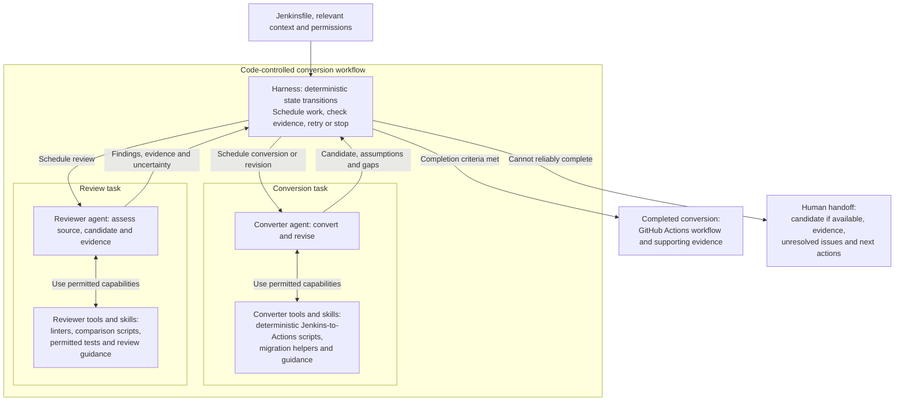
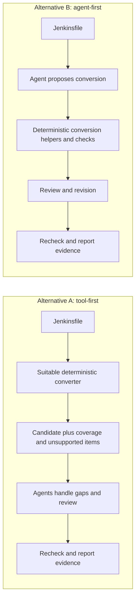

# Design options for the conversion module

## Richer deterministic workflow

The aim is to advance the Jenkins-to-GitHub-Actions conversion as far as the
available tools, context and permissions reliably support. A converter can
use a deterministic script to do supported translation work, not just ask an
LLM to write everything. A reviewer can use different capabilities to inspect
the candidate and gather evidence.

The harness declares completion only when its configured criteria are met by
the current candidate and evidence, not merely because an agent claims
success. If reliable completion is not supported, the handoff preserves any
useful candidate and explains what was achieved, what remains uncertain or
unsupported, and what a human needs to decide, supply or change. Completion
does not by itself mean deployment readiness or proven runtime equivalence.

## Tools-first vs Agents-first

